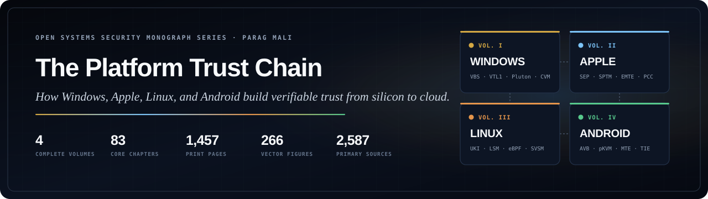
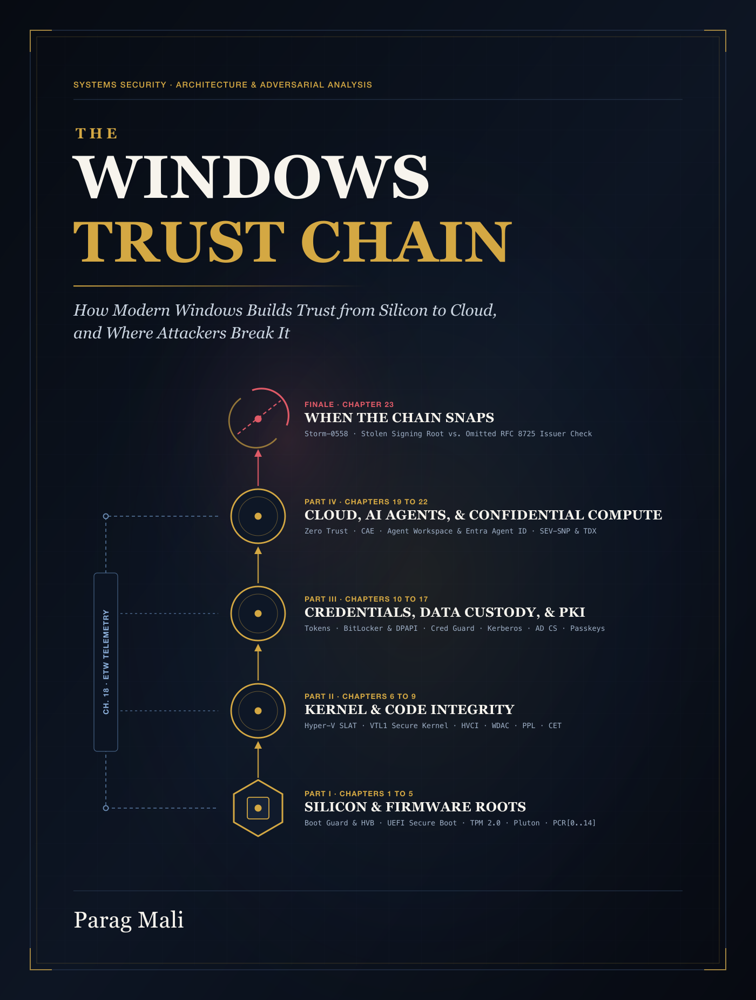
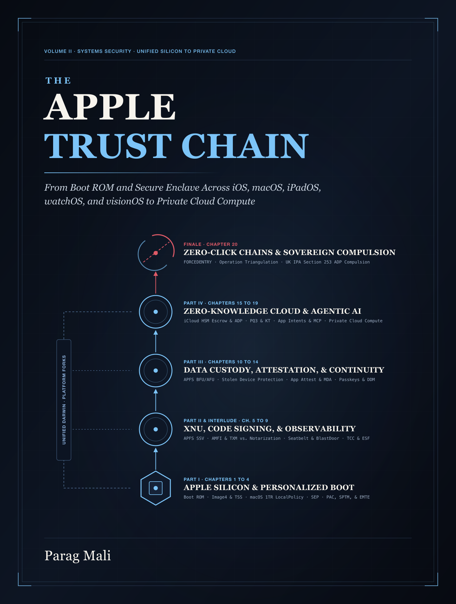
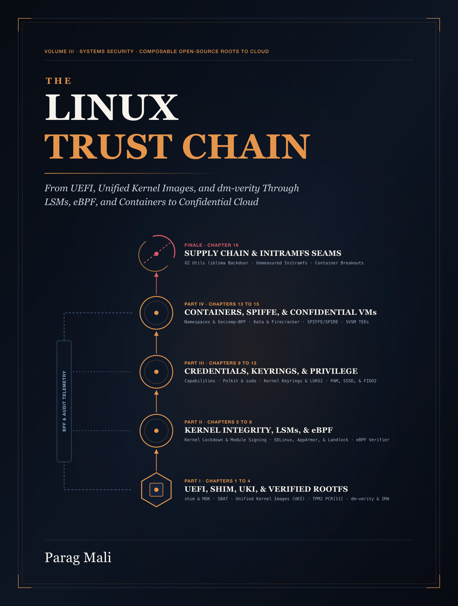
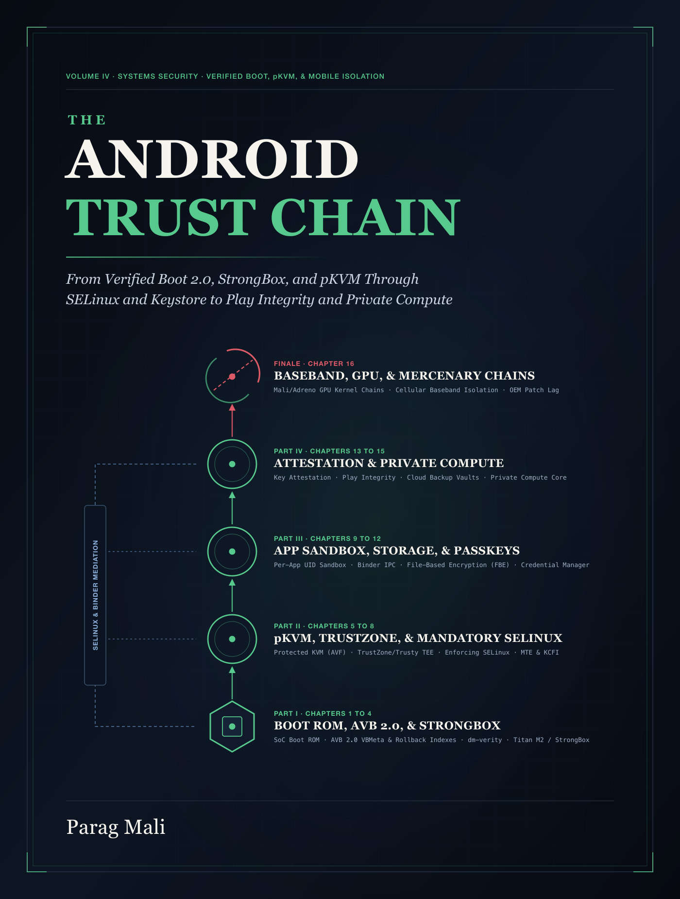

<p align="center">
  <a href="https://maliparag.github.io/trust-chain/">
    
  </a>
</p>

<p align="center">
  <a href="https://maliparag.github.io/trust-chain/"></a>
  <a href="https://maliparag.github.io/trust-chain/"></a>
  <a href="editorial.md"></a>
  <a href="LICENSE"></a>
</p>

<p align="center">
  <strong><a href="https://maliparag.github.io/trust-chain/">Series Showcase</a></strong>
  &nbsp;&middot;&nbsp;
  <a href="https://maliparag.github.io/trust-chain/windows/">Vol. I: Windows</a>
  &nbsp;&middot;&nbsp;
  <a href="https://maliparag.github.io/trust-chain/apple/">Vol. II: Apple</a>
  &nbsp;&middot;&nbsp;
  <a href="https://maliparag.github.io/trust-chain/linux/">Vol. III: Linux</a>
  &nbsp;&middot;&nbsp;
  <a href="https://maliparag.github.io/trust-chain/android/">Vol. IV: Android</a>
  &nbsp;&middot;&nbsp;
  <a href="editorial.md">Editorial Playbook</a>
</p>

---

**The Platform Trust Chain Series** is a four-volume collection of open systems-security monographs by [Parag Mali](https://paragmali.com). Each book traces one operating system ecosystem from its hardware reset vector through hypervisors, kernel memory monitors, code signing, inter-process containment, credential vaults, runtime telemetry, remote attestation, confidential cloud enclaves, and autonomous AI agent sandboxes, isolating the exact architectural seams where real-world exploit chains break through.

## The Four Complete Volumes

<table>
  <tr>
    <td width="25%" align="center" valign="top">
      <a href="https://maliparag.github.io/trust-chain/windows/">
        
      </a>
      <br>
      <strong>Vol. I &middot; Windows</strong><br>
      <sub>23 Ch &middot; 379 pp &middot; 76 SVGs &middot; 912 Refs</sub><br><br>
      <a href="https://maliparag.github.io/trust-chain/windows/"><strong>Read Online</strong></a> &middot;
      <a href="https://maliparag.github.io/trust-chain/windows/the-windows-trust-chain.pdf">PDF (10.0 MB)</a>
    </td>
    <td width="25%" align="center" valign="top">
      <a href="https://maliparag.github.io/trust-chain/apple/">
        
      </a>
      <br>
      <strong>Vol. II &middot; Apple</strong><br>
      <sub>20 Ch &middot; 357 pp &middot; 64 SVGs &middot; 545 Refs</sub><br><br>
      <a href="https://maliparag.github.io/trust-chain/apple/"><strong>Read Online</strong></a> &middot;
      <a href="https://maliparag.github.io/trust-chain/apple/the-apple-trust-chain.pdf">PDF (11.0 MB)</a>
    </td>
    <td width="25%" align="center" valign="top">
      <a href="https://maliparag.github.io/trust-chain/linux/">
        
      </a>
      <br>
      <strong>Vol. III &middot; Linux</strong><br>
      <sub>20 Ch &middot; 363 pp &middot; 63 SVGs &middot; 577 Refs</sub><br><br>
      <a href="https://maliparag.github.io/trust-chain/linux/"><strong>Read Online</strong></a> &middot;
      <a href="https://maliparag.github.io/trust-chain/linux/the-linux-trust-chain.pdf">PDF (11.4 MB)</a>
    </td>
    <td width="25%" align="center" valign="top">
      <a href="https://maliparag.github.io/trust-chain/android/">
        
      </a>
      <br>
      <strong>Vol. IV &middot; Android</strong><br>
      <sub>20 Ch &middot; 358 pp &middot; 63 SVGs &middot; 553 Refs</sub><br><br>
      <a href="https://maliparag.github.io/trust-chain/android/"><strong>Read Online</strong></a> &middot;
      <a href="https://maliparag.github.io/trust-chain/android/the-android-trust-chain.pdf">PDF (11.3 MB)</a>
    </td>
  </tr>
</table>

## Cross-Platform Trust Architecture at a Glance

Although all four platforms confront the same physical and cryptographic constraints, each makes a distinct architectural bet shaped by its hardware governance and compatibility history:

| Trust Layer | Vol. I &middot; Windows | Vol. II &middot; Apple (`iOS` / `macOS` / `visionOS`) | Vol. III &middot; Linux | Vol. IV &middot; Android |
|---|---|---|---|---|
| **1. Reset & Boot Root** | `Boot Guard` / `PSB`, `UEFI` `db`/`dbx`, `Pluton`, `Measured Boot` `PCR[0..7]` | Immutable `Boot ROM`, per-`ECID` + `ApNonce` `Image4`/`TSS` tickets, `macOS` `1TR` `LocalPolicy` | `UEFI` `shim`/`MOK`/`SBAT`, signed `UKI` PE bundles, `systemd-pcrlock` `PCR[11]` | SoC `Boot ROM` fuses, `GREEN`/`YELLOW`/`ORANGE` lock states, `AVB 2.0` `VBMeta` & `RPMB` rollback |
| **2. Monitors & Memory** | `Hyper-V` `SLAT` (`VTL0` vs. `VTL1` Secure Kernel), `HVCI`, `CET` Shadow Stacks, `kCFG` | Orthogonal `SPTM` (`GL2`) & `TXM` (`GL0`), `ARM PAC`, `Exclaves`, `A19`/`M5` `EMTE` (`MIE`) | `Kernel Lockdown`, `KCFI` / `FineIBT`, `CET`, `SLAB_VIRTUAL`, Rust-for-Linux drivers | `EL2` `Protected KVM` (`pKVM` / `AVF` + `DICE`), `Titan M2` `StrongBox`, `Arm MTE` + `Scudo` |
| **3. Code & Containment** | `WDAC` (`App Control`), `PPL` signer lattice, `MIC` Integrity Levels, `AppContainer` | `APFS` `SSV` + Cryptexes, `AMFI` / Launch Constraints, `XPC` `audit_token_t`, `Seatbelt`, `BlastDoor`, `TCC` | `dm-verity`, `fs-verity`, `IPE` LSM, stacked `SELinux` / `AppArmor` / `Landlock`, `systemd` `run0` | Per-app `AID_*` `UID`, universal `SELinux` `neverallow` CTS gates, `Binder` capabilities, `Advanced Protection` |
| **4. Runtime Telemetry** | Kernel `ETW`, `EtwTi` Threat-Intelligence `PPL` feeds, `AMSI`, Autologgers | `macOS` `EndpointSecurity` (`ESF`) & `XProtect` `Bastion`; locked `iOS` `sysdiagnose` forensics | `LSM-BPF` synchronous hooks (`Tetragon`), `eBPF` ring buffers (`Falco`/`Tracee`), `IMA` | `Play Protect` Dynamic Signal Monitoring, enterprise `SecurityLog`, E2EE Cloud `Intrusion Logging` |
| **5. Custody & Identity** | `BitLocker`, `DPAPI`/`KeyIso`, `Credential Guard`, `Kerberos`/`dMSA`, `PRT`, `Hello` Passkeys | `APFS` Classes `A`-`D`, 72h `BFU` reboot, `Stolen Device Protection`, `App Attest`, `ACME` `MDA`, `DDM`/`PSSO` | Kernel Keyrings, `TPM2` `systemd-creds`, `PAM`/`SSSD`, OpenSSH Certificates + `FIDO2`, `SPIFFE`/`SPIRE` | `fscrypt` v2 Inline Crypto (`ICE`), `Weaver` + `Identity Check`, X.509 `Key Attestation` & `RKP` |
| **6. Cloud, AI, & Seams** | `CAE`, `Agent Workspace` + `Entra Agent ID`, `Azure CVM` (`SEV-SNP`/`TDX`), `Storm-0558` | `iCloud HSM` + `ADP`, `iMessage PQ3` + `KT`, `App Intents` + `.onToolCall`, `Private Cloud Compute`, UK `IPA` s.253 | `gVisor` & `Firecracker` AI sandboxes, credential proxies, `COCONUT-SVSM` (`VMPL0`), `CoCo`, `XZ Utils` | `AICore` + `Private Compute Core`, `AppFunctions`, `Secure Virtual Window`, `Private AI Compute` (`TIE`), Patch Gap |

## Complete Chapter Directory (83 Chapters)

Expand any volume below to browse its full chapter progression or jump directly to the rendered web chapter or Markdown source:

<details>
<summary><strong>Volume I &middot; The Windows Trust Chain</strong> (23 Chapters &middot; 379 Pages &middot; 76 SVG Figures &middot; 912 Primary Sources)</summary>

| Part | Chapter | Online & Source |
|---|---|---|
| Opening | Prologue & Foundations | [Prologue](books/windows/src/chapters/00-prologue.md) &middot; [Foundations](books/windows/src/chapters/00b-foundations.md) |
| Part I · Silicon | **1.** Secure Boot | [Read](https://maliparag.github.io/trust-chain/windows/chapters/16-secure-boot.html) &middot; [Source](books/windows/src/chapters/16-secure-boot.md) |
| Part I · Silicon | **2.** The TPM | [Read](https://maliparag.github.io/trust-chain/windows/chapters/01-tpm.html) &middot; [Source](books/windows/src/chapters/01-tpm.md) |
| Part I · Silicon | **3.** Pluton | [Read](https://maliparag.github.io/trust-chain/windows/chapters/02-pluton.html) &middot; [Source](books/windows/src/chapters/02-pluton.md) |
| Part I · Silicon | **4.** Measured Boot | [Read](https://maliparag.github.io/trust-chain/windows/chapters/03-measured-boot.html) &middot; [Source](books/windows/src/chapters/03-measured-boot.md) |
| Part I · Silicon | **5.** Attestation | [Read](https://maliparag.github.io/trust-chain/windows/chapters/04-attestation.html) &middot; [Source](books/windows/src/chapters/04-attestation.md) |
| Part II · Kernel & Code | **6.** The Secure Kernel and VBS | [Read](https://maliparag.github.io/trust-chain/windows/chapters/05-secure-kernel.html) &middot; [Source](books/windows/src/chapters/05-secure-kernel.md) |
| Part II · Kernel & Code | **7.** Code Integrity and Application Control | [Read](https://maliparag.github.io/trust-chain/windows/chapters/06-code-integrity.html) &middot; [Source](books/windows/src/chapters/06-code-integrity.md) |
| Part II · Kernel & Code | **8.** Protected Process Light | [Read](https://maliparag.github.io/trust-chain/windows/chapters/18-ppl.html) &middot; [Source](books/windows/src/chapters/18-ppl.md) |
| Part II · Kernel & Code | **9.** Process Mitigation Policies | [Read](https://maliparag.github.io/trust-chain/windows/chapters/19-mitigations.html) &middot; [Source](books/windows/src/chapters/19-mitigations.md) |
| Part III · Credentials & Access | **10.** Windows Access Control, Integrity Levels, and Impersonation | [Read](https://maliparag.github.io/trust-chain/windows/chapters/25-access-control.html) &middot; [Source](books/windows/src/chapters/25-access-control.md) |
| Part III · Credentials & Access | **11.** Data Protection and Local Secret Custody | [Read](https://maliparag.github.io/trust-chain/windows/chapters/30-data-protection.html) &middot; [Source](books/windows/src/chapters/30-data-protection.md) |
| Part III · Credentials & Access | **12.** Credential Guard and LSASS Isolation | [Read](https://maliparag.github.io/trust-chain/windows/chapters/08-credential-guard.html) &middot; [Source](books/windows/src/chapters/08-credential-guard.md) |
| Part III · Credentials & Access | **13.** The Death of NTLM | [Read](https://maliparag.github.io/trust-chain/windows/chapters/09-ntlm.html) &middot; [Source](books/windows/src/chapters/09-ntlm.md) |
| Part III · Credentials & Access | **14.** Kerberos and Ticket Forgery | [Read](https://maliparag.github.io/trust-chain/windows/chapters/10-kerberos.html) &middot; [Source](books/windows/src/chapters/10-kerberos.md) |
| Part III · Credentials & Access | **15.** Enterprise PKI, Service Identities, and Hybrid Bridges | [Read](https://maliparag.github.io/trust-chain/windows/chapters/31-enterprise-pki.html) &middot; [Source](books/windows/src/chapters/31-enterprise-pki.md) |
| Part III · Credentials & Access | **16.** Pass-the-Hash to Pass-the-PRT | [Read](https://maliparag.github.io/trust-chain/windows/chapters/11-pth-prt.html) &middot; [Source](books/windows/src/chapters/11-pth-prt.md) |
| Part III · Credentials & Access | **17.** Windows Hello and Passkeys | [Read](https://maliparag.github.io/trust-chain/windows/chapters/12-hello.html) &middot; [Source](books/windows/src/chapters/12-hello.md) |
| Interlude · Watching the Chain | **18.** ETW: The EDR Substrate | [Read](https://maliparag.github.io/trust-chain/windows/chapters/28-etw.html) &middot; [Source](books/windows/src/chapters/28-etw.md) |
| Part IV · Cloud | **19.** Zero Trust | [Read](https://maliparag.github.io/trust-chain/windows/chapters/13-zero-trust.html) &middot; [Source](books/windows/src/chapters/13-zero-trust.md) |
| Part IV · Cloud | **20.** Continuous Access Evaluation | [Read](https://maliparag.github.io/trust-chain/windows/chapters/14-cae.html) &middot; [Source](books/windows/src/chapters/14-cae.md) |
| Part IV · Cloud | **21.** Workload and AI Agent Security | [Read](https://maliparag.github.io/trust-chain/windows/chapters/32-agent-security.html) &middot; [Source](books/windows/src/chapters/32-agent-security.md) |
| Part IV · Cloud | **22.** Confidential VMs | [Read](https://maliparag.github.io/trust-chain/windows/chapters/29-confidential-vms.html) &middot; [Source](books/windows/src/chapters/29-confidential-vms.md) |
| Finale · When the Chain Snaps | **23.** When the Chain Snaps: Storm-0558 | [Read](https://maliparag.github.io/trust-chain/windows/chapters/15-storm0558.html) &middot; [Source](books/windows/src/chapters/15-storm0558.md) |

</details>
<details>
<summary><strong>Volume II &middot; The Apple Trust Chain</strong> (20 Chapters &middot; 357 Pages &middot; 64 SVG Figures &middot; 545 Primary Sources)</summary>

| Part | Chapter | Online & Source |
|---|---|---|
| Opening | Prologue & Foundations | [Prologue](books/apple/src/chapters/00-prologue.md) &middot; [Foundations](books/apple/src/chapters/00b-foundations.md) |
| Part I | **1.** Immutable Boot ROM, iBoot, and Image4 Personalization | [Read](https://maliparag.github.io/trust-chain/apple/chapters/01-secure-boot.html) &middot; [Source](books/apple/src/chapters/01-secure-boot.md) |
| Part I | **2.** The Apple Silicon Mac Fork: One True Recovery and LocalPolicy | [Read](https://maliparag.github.io/trust-chain/apple/chapters/02-mac-localpolicy.html) &middot; [Source](books/apple/src/chapters/02-mac-localpolicy.md) |
| Part I | **3.** The Secure Enclave, Silicon UIDs, and Biometric Pipelines | [Read](https://maliparag.github.io/trust-chain/apple/chapters/03-secure-enclave.html) &middot; [Source](books/apple/src/chapters/03-secure-enclave.md) |
| Part I | **4.** Hardware Monitors and Memory Integrity Enforcement | [Read](https://maliparag.github.io/trust-chain/apple/chapters/04-silicon-memory-safety.html) &middot; [Source](books/apple/src/chapters/04-silicon-memory-safety.md) |
| Part II | **5.** APFS Signed System Volume, Cryptexes, and Shared Cache Trust | [Read](https://maliparag.github.io/trust-chain/apple/chapters/05-apfs-ssv-dyld.html) &middot; [Source](books/apple/src/chapters/05-apfs-ssv-dyld.md) |
| Part II | **6.** AMFI, TXM Trust Caches, Launch Constraints, and Notarization | [Read](https://maliparag.github.io/trust-chain/apple/chapters/06-amfi-txm-notarization.html) &middot; [Source](books/apple/src/chapters/06-amfi-txm-notarization.md) |
| Part II | **7.** Mach IPC, XPC Audit Tokens, Seatbelt, and BlastDoor | [Read](https://maliparag.github.io/trust-chain/apple/chapters/07-ipc-seatbelt-blastdoor.html) &middot; [Source](books/apple/src/chapters/07-ipc-seatbelt-blastdoor.md) |
| Part II | **8.** macOS Privacy Governance, TCC, and System Extensions | [Read](https://maliparag.github.io/trust-chain/apple/chapters/08-macos-tcc-sysext.html) &middot; [Source](books/apple/src/chapters/08-macos-tcc-sysext.md) |
| Interlude | **9.** EndpointSecurity, XProtect, and Locked-Device Forensics | [Read](https://maliparag.github.io/trust-chain/apple/chapters/09-esf-xprotect-forensics.html) &middot; [Source](books/apple/src/chapters/09-esf-xprotect-forensics.md) |
| Part III | **10.** APFS Per-File Data Protection, BFU/AFU States, and Lockdown Mode | [Read](https://maliparag.github.io/trust-chain/apple/chapters/10-apfs-data-protection.html) &middot; [Source](books/apple/src/chapters/10-apfs-data-protection.md) |
| Part III | **11.** Keychain Custody, Legacy macOS Gaps, and Stolen Device Protection | [Read](https://maliparag.github.io/trust-chain/apple/chapters/11-keychain-stolen-device.html) &middot; [Source](books/apple/src/chapters/11-keychain-stolen-device.md) |
| Part III | **12.** Hardware Key Attestation, App Attest, and Managed Device Attestation | [Read](https://maliparag.github.io/trust-chain/apple/chapters/12-sep-app-device-attestation.html) &middot; [Source](books/apple/src/chapters/12-sep-app-device-attestation.md) |
| Part III | **13.** Apple Account, Passkeys, Continuity, and Spatial Gaze Isolation | [Read](https://maliparag.github.io/trust-chain/apple/chapters/13-accounts-passkeys-continuity.html) &middot; [Source](books/apple/src/chapters/13-accounts-passkeys-continuity.md) |
| Part III | **14.** Automated Enrollment, Declarative Device Management, and Platform SSO | [Read](https://maliparag.github.io/trust-chain/apple/chapters/14-ddm-platform-sso.html) &middot; [Source](books/apple/src/chapters/14-ddm-platform-sso.md) |
| Part IV | **15.** CloudKit End-to-End Encryption, HSM Escrow, and Advanced Data Protection | [Read](https://maliparag.github.io/trust-chain/apple/chapters/15-icloud-hsm-adp.html) &middot; [Source](books/apple/src/chapters/15-icloud-hsm-adp.md) |
| Part IV | **16.** iMessage PQ3 Post-Quantum Ratcheting and Contact Key Verification | [Read](https://maliparag.github.io/trust-chain/apple/chapters/16-imessage-pq3-kt.html) &middot; [Source](books/apple/src/chapters/16-imessage-pq3-kt.md) |
| Part IV | **17.** Offline Find My Cryptography and Anti-Tracking Bounds | [Read](https://maliparag.github.io/trust-chain/apple/chapters/17-find-my-anti-tracking.html) &middot; [Source](books/apple/src/chapters/17-find-my-anti-tracking.md) |
| Part IV | **18.** On-Device Agentic AI, App Intents, MCP Agents, and Micro-VMs | [Read](https://maliparag.github.io/trust-chain/apple/chapters/18-agentic-ai-workload-isolation.html) &middot; [Source](books/apple/src/chapters/18-agentic-ai-workload-isolation.md) |
| Part IV | **19.** Private Cloud Compute and Verifiable Cloud Inference | [Read](https://maliparag.github.io/trust-chain/apple/chapters/19-private-cloud-compute.html) &middot; [Source](books/apple/src/chapters/19-private-cloud-compute.md) |
| Finale | **20.** Mercenary Zero-Click Chains and Sovereign Cloud Compulsion | [Read](https://maliparag.github.io/trust-chain/apple/chapters/20-mercenary-chains-compulsion.html) &middot; [Source](books/apple/src/chapters/20-mercenary-chains-compulsion.md) |

</details>
<details>
<summary><strong>Volume III &middot; The Linux Trust Chain</strong> (20 Chapters &middot; 363 Pages &middot; 63 SVG Figures &middot; 577 Primary Sources)</summary>

| Part | Chapter | Online & Source |
|---|---|---|
| Opening | Prologue & Foundations | [Prologue](books/linux/src/chapters/00-prologue.md) &middot; [Foundations](books/linux/src/chapters/00b-foundations.md) |
| Part I | **1.** UEFI, shim, Machine Owner Keys, and SBAT Revocation | [Read](https://maliparag.github.io/trust-chain/linux/chapters/01-uefi-shim-sbat.html) &middot; [Source](books/linux/src/chapters/01-uefi-shim-sbat.md) |
| Part I | **2.** Unified Kernel Images, systemd-stub, and TPM2 PCR Policies | [Read](https://maliparag.github.io/trust-chain/linux/chapters/02-uki-systemd-pcrlock.html) &middot; [Source](books/linux/src/chapters/02-uki-systemd-pcrlock.md) |
| Part I | **3.** Block and File Integrity: LUKS2, dm-verity, and fs-verity | [Read](https://maliparag.github.io/trust-chain/linux/chapters/03-luks2-verity.html) &middot; [Source](books/linux/src/chapters/03-luks2-verity.md) |
| Part I | **4.** Runtime Appraisal and Attestation: IMA, IPE, and Keylime | [Read](https://maliparag.github.io/trust-chain/linux/chapters/04-ima-ipe-keylime.html) &middot; [Source](books/linux/src/chapters/04-ima-ipe-keylime.md) |
| Part II | **5.** Kernel Lockdown, Signed Modules, and kexec Gates | [Read](https://maliparag.github.io/trust-chain/linux/chapters/05-kernel-lockdown-modules.html) &middot; [Source](books/linux/src/chapters/05-kernel-lockdown-modules.md) |
| Part II | **6.** Kernel Memory Hardening, Control-Flow Integrity, and Rust | [Read](https://maliparag.github.io/trust-chain/linux/chapters/06-kernel-memory-rust.html) &middot; [Source](books/linux/src/chapters/06-kernel-memory-rust.md) |
| Part II | **7.** Stacked Linux Security Modules: SELinux, AppArmor, and Landlock | [Read](https://maliparag.github.io/trust-chain/linux/chapters/07-stacked-lsms-landlock.html) &middot; [Source](books/linux/src/chapters/07-stacked-lsms-landlock.md) |
| Interlude | **8.** The eBPF Dual Edge: Runtime Security Enforcement vs. Verifier Escapes | [Read](https://maliparag.github.io/trust-chain/linux/chapters/08-ebpf-dual-edge.html) &middot; [Source](books/linux/src/chapters/08-ebpf-dual-edge.md) |
| Part III | **9.** POSIX Capabilities and the Unprivileged User Namespace Surface | [Read](https://maliparag.github.io/trust-chain/linux/chapters/09-capabilities-userns.html) &middot; [Source](books/linux/src/chapters/09-capabilities-userns.md) |
| Part III | **10.** Killing SUID: From sudo and Polkit to systemd run0 | [Read](https://maliparag.github.io/trust-chain/linux/chapters/10-suid-to-run0.html) &middot; [Source](books/linux/src/chapters/10-suid-to-run0.md) |
| Part III | **11.** Service Sandboxing and D-Bus IPC Mediation | [Read](https://maliparag.github.io/trust-chain/linux/chapters/11-systemd-dbus-sandboxing.html) &middot; [Source](books/linux/src/chapters/11-systemd-dbus-sandboxing.md) |
| Part III | **12.** Local Secret Custody: Kernel Keyrings, systemd-creds, and TPM2 PKCS#11 | [Read](https://maliparag.github.io/trust-chain/linux/chapters/12-keyrings-systemd-creds.html) &middot; [Source](books/linux/src/chapters/12-keyrings-systemd-creds.md) |
| Part III | **13.** PAM, Hybrid Enterprise Identity, OpenSSH Certificates, and regreSSHion | [Read](https://maliparag.github.io/trust-chain/linux/chapters/13-pam-ssh-fido2.html) &middot; [Source](books/linux/src/chapters/13-pam-ssh-fido2.md) |
| Part IV | **14.** Shared-Kernel Containers: Namespaces, cgroups v2, seccomp, and Escapes | [Read](https://maliparag.github.io/trust-chain/linux/chapters/14-containers-escapes.html) &middot; [Source](books/linux/src/chapters/14-containers-escapes.md) |
| Part IV | **15.** De-Privileged Runtimes: gVisor User-Space Kernels and KVM Micro-VMs | [Read](https://maliparag.github.io/trust-chain/linux/chapters/15-gvisor-microvms.html) &middot; [Source](books/linux/src/chapters/15-gvisor-microvms.md) |
| Part IV | **16.** Cloud Workload Identity: OIDC Projections, IMDSv2, and SPIFFE/SPIRE | [Read](https://maliparag.github.io/trust-chain/linux/chapters/16-workload-identity-spiffe.html) &middot; [Source](books/linux/src/chapters/16-workload-identity-spiffe.md) |
| Part IV | **17.** Isolating AI Coding Agents, MCP Servers, and Untrusted Code Execution | [Read](https://maliparag.github.io/trust-chain/linux/chapters/17-ai-agent-sandboxes.html) &middot; [Source](books/linux/src/chapters/17-ai-agent-sandboxes.md) |
| Part IV | **18.** Confidential VMs and Open Paravisors: SEV-SNP, TDX, and COCONUT-SVSM | [Read](https://maliparag.github.io/trust-chain/linux/chapters/18-confidential-vms-svsm.html) &middot; [Source](books/linux/src/chapters/18-confidential-vms-svsm.md) |
| Part IV | **19.** Confidential Containers, Trustee Attestation, and Sealed AI Workloads | [Read](https://maliparag.github.io/trust-chain/linux/chapters/19-confidential-containers.html) &middot; [Source](books/linux/src/chapters/19-confidential-containers.md) |
| Finale | **20.** Open-Source Supply-Chain Subversion: XZ Utils, Sigstore, and Reproducible Builds | [Read](https://maliparag.github.io/trust-chain/linux/chapters/20-xz-supply-chain-provenance.html) &middot; [Source](books/linux/src/chapters/20-xz-supply-chain-provenance.md) |

</details>
<details>
<summary><strong>Volume IV &middot; The Android Trust Chain</strong> (20 Chapters &middot; 358 Pages &middot; 63 SVG Figures &middot; 553 Primary Sources)</summary>

| Part | Chapter | Online & Source |
|---|---|---|
| Opening | Prologue & Foundations | [Prologue](books/android/src/chapters/00-prologue.md) &middot; [Foundations](books/android/src/chapters/00b-foundations.md) |
| Part I · Silicon, Verified Boot, & Hardware KeyMint | **1.** SoC Boot ROM, Bootloader Lock States, and AVB 2.0 VBMeta | [Read](https://maliparag.github.io/trust-chain/android/chapters/01-bootrom-avb-vbmeta.html) &middot; [Source](books/android/src/chapters/01-bootrom-avb-vbmeta.md) |
| Part I · Silicon, Verified Boot, & Hardware KeyMint | **2.** Anti-Rollback Indexes, dm-verity, fs-verity, and APEX Mainline | [Read](https://maliparag.github.io/trust-chain/android/chapters/02-antirollback-verity-apex.html) &middot; [Source](books/android/src/chapters/02-antirollback-verity-apex.md) |
| Part I · Silicon, Verified Boot, & Hardware KeyMint | **3.** Arm TrustZone TEEs vs. Discrete StrongBox Security Processors | [Read](https://maliparag.github.io/trust-chain/android/chapters/03-trustzone-strongbox.html) &middot; [Source](books/android/src/chapters/03-trustzone-strongbox.md) |
| Part I · Silicon, Verified Boot, & Hardware KeyMint | **4.** KeyMint Authorization Tags, Boot Binding, and Weaver Throttling | [Read](https://maliparag.github.io/trust-chain/android/chapters/04-keymint-weaver-throttling.html) &middot; [Source](books/android/src/chapters/04-keymint-weaver-throttling.md) |
| Part II · De-Privileging the Kernel | **5.** Protected KVM and the Android Virtualization Framework | [Read](https://maliparag.github.io/trust-chain/android/chapters/05-pkvm-avf-microdroid.html) &middot; [Source](books/android/src/chapters/05-pkvm-avf-microdroid.md) |
| Part II · De-Privileging the Kernel | **6.** Universal Enforcing SELinux, CTS neverallow Gates, and seccomp-BPF | [Read](https://maliparag.github.io/trust-chain/android/chapters/06-selinux-seccomp.html) &middot; [Source](books/android/src/chapters/06-selinux-seccomp.md) |
| Part II · De-Privileging the Kernel | **7.** Project Treble HALs, Generic Kernel Image, KCFI, and Kernel Rust | [Read](https://maliparag.github.io/trust-chain/android/chapters/07-treble-gki-rust.html) &middot; [Source](books/android/src/chapters/07-treble-gki-rust.md) |
| Part II · De-Privileging the Kernel | **8.** Hardware Arm MTE and Hardened Heap Allocation in Production | [Read](https://maliparag.github.io/trust-chain/android/chapters/08-arm-mte-scudo.html) &middot; [Source](books/android/src/chapters/08-arm-mte-scudo.md) |
| Part III · App Sandbox, Storage, & Local Identity | **9.** Per-App UID Sandboxing, WebView Isolation, and Binder IPC | [Read](https://maliparag.github.io/trust-chain/android/chapters/09-uid-zygote-binder.html) &middot; [Source](books/android/src/chapters/09-uid-zygote-binder.md) |
| Part III · App Sandbox, Storage, & Local Identity | **10.** APK Signature Schemes, Developer Verification, and Scoped Storage | [Read](https://maliparag.github.io/trust-chain/android/chapters/10-apk-signing-scoped-storage.html) &middot; [Source](books/android/src/chapters/10-apk-signing-scoped-storage.md) |
| Part III · App Sandbox, Storage, & Local Identity | **11.** UI-Layer Bypasses, Banking Trojans, and Advanced Protection Lockdown | [Read](https://maliparag.github.io/trust-chain/android/chapters/11-accessibility-advanced-protection.html) &middot; [Source](books/android/src/chapters/11-accessibility-advanced-protection.md) |
| Part III · App Sandbox, Storage, & Local Identity | **12.** File-Based Encryption, Physical USB Zero-Days, and Theft Locks | [Read](https://maliparag.github.io/trust-chain/android/chapters/12-fbe-usb-theft-protection.html) &middot; [Source](books/android/src/chapters/12-fbe-usb-theft-protection.md) |
| Part III · App Sandbox, Storage, & Local Identity | **13.** BiometricPrompt Strength Tiers and Credential Manager Passkeys | [Read](https://maliparag.github.io/trust-chain/android/chapters/13-biometrics-passkeys.html) &middot; [Source](books/android/src/chapters/13-biometrics-passkeys.md) |
| Interlude · Mobile Telemetry & Tamper-Evident Forensics | **14.** Play Protect, Dynamic Signal Monitoring, and E2EE Intrusion Logging | [Read](https://maliparag.github.io/trust-chain/android/chapters/14-play-protect-intrusion-logging.html) &middot; [Source](books/android/src/chapters/14-play-protect-intrusion-logging.md) |
| Part IV · Remote Attestation, Enterprise, & Agentic AI | **15.** Hardware Key Attestation and Remote Key Provisioning | [Read](https://maliparag.github.io/trust-chain/android/chapters/15-key-attestation-rkp.html) &middot; [Source](books/android/src/chapters/15-key-attestation-rkp.md) |
| Part IV · Remote Attestation, Enterprise, & Agentic AI | **16.** Play Integrity Verdicts vs. Root Hiding and Leaked Keyboxes | [Read](https://maliparag.github.io/trust-chain/android/chapters/16-play-integrity-keybox-wars.html) &middot; [Source](books/android/src/chapters/16-play-integrity-keybox-wars.md) |
| Part IV · Remote Attestation, Enterprise, & Agentic AI | **17.** Android Enterprise: Work Profiles, COPE, and Zero-Touch | [Read](https://maliparag.github.io/trust-chain/android/chapters/17-android-enterprise.html) &middot; [Source](books/android/src/chapters/17-android-enterprise.md) |
| Part IV · Remote Attestation, Enterprise, & Agentic AI | **18.** On-Device Agentic AI: AICore, Private Compute Core, and AppFunctions | [Read](https://maliparag.github.io/trust-chain/android/chapters/18-on-device-agentic-ai.html) &middot; [Source](books/android/src/chapters/18-on-device-agentic-ai.md) |
| Part IV · Remote Attestation, Enterprise, & Agentic AI | **19.** E2EE Backup Vaults and Private AI Compute | [Read](https://maliparag.github.io/trust-chain/android/chapters/19-e2ee-backups-private-ai-compute.html) &middot; [Source](books/android/src/chapters/19-e2ee-backups-private-ai-compute.md) |
| Finale · Where the Multi-Vendor Chain Snaps | **20.** Multi-Vendor Chain Breaks: GPUs, Basebands, Trustlets, and the Patch Gap | [Read](https://maliparag.github.io/trust-chain/android/chapters/20-multivendor-spyware-chains.html) &middot; [Source](books/android/src/chapters/20-multivendor-spyware-chains.md) |

</details>

## Series Statistics & Mechanical Verification

Every commit in this repository is checked by deterministic build and audit scripts so prose quality, citations, mathematical notation, and vector diagrams never drift:

| Metric | Vol. I &middot; Windows | Vol. II &middot; Apple | Vol. III &middot; Linux | Vol. IV &middot; Android | **Series Total** |
|---|---:|---:|---:|---:|---:|
| **Print Pages (`7.00 x 9.25 in`)** | 379 | 357 | 363 | 358 | **1,457** |
| **Total Words** | 99,668 | 101,136 | 101,934 | 101,649 | **404,387** |
| **Numbered Core Chapters** | 23 | 20 | 20 | 20 | **83** |
| **Collision-Verified SVG Figures** | 76 | 64 | 63 | 63 | **266** |
| **Sequential Primary Sources** | 912 | 545 | 577 | 553 | **2,587** |

1. **Sustained Monograph Prose (`tools/audit_book.py`):** Enforces zero body bullet lists outside structured five-coordinate `Overview` cards, zero inline paragraph or table-cell bolding, zero leaked repository paths, bounded (`1-4` line) live diagnostic blocks, and `100%` sequential citation and chapter-number parity.
2. **Programmatic Orthogonal Diagrams (`tools/diagram_lib.py`):** Generates all 266 vector figures from Python specifications and runs seven geometric assertions on every build (no text-on-text, line-through-text, pill-on-arrowhead, pill-on-card, card-on-card, non-orthogonal connector, or parallel double-track overlaps).
3. **Overflow-Free Web & Print Pagination (`tools/build-pdf.mjs`):** Compiles each volume via headless Chromium W3C CSS `@page` rules at `7.00 x 9.25 in` with full-bleed vector front and back covers, KaTeX display-math clamping, content-weighted `<colgroup>` tables, native PDF bookmark outlines, and DOM horizontal-overflow assertions.

## Build, Audit, and Author Locally

Requires [mdBook](https://rust-lang.github.io/mdBook/) (`0.4.43+`), Node.js (`20+`), Python `3.10+`, and Google Chrome or Chromium (only when compiling PDFs).

```bash
npm install
npm run audit                        # verify prose, citations, and links across all 4 volumes
npm run diagrams                     # regenerate and collision-verify all 266 SVG figures
npm run summary                      # regenerate src/SUMMARY.md from books/*/house.json
npm run build                        # build showcase + all 4 web volumes into ./book
npm run pdfs                         # compile all four 7 x 9.25 in PDF editions
(cd books/apple && mdbook serve -o)  # live-reload preview while editing a single volume
```

## Repository Structure

```text
trust-chain/
├── assets/
│   └── readme-hero.svg           Series vector hero banner
├── books/
│   ├── windows/                  Volume I: The Windows Trust Chain (23 ch, 379 pp)
│   ├── apple/                    Volume II: The Apple Trust Chain (20 ch, 357 pp)
│   ├── linux/                    Volume III: The Linux Trust Chain (20 ch, 363 pp)
│   └── android/                  Volume IV: The Android Trust Chain (20 ch, 358 pp)
├── editorial.md                  Universal Book-Craft Playbook + per-volume house design
├── theme/                        Shared mdBook monograph CSS, KaTeX head, & volume switcher
└── tools/
    ├── books.json                Declarative registry of volumes, metrics, mounts, & GA4
    ├── audit_book.py             Multi-volume prose, typography, citation, & link verifier
    ├── diagram_lib.py            7-way collision- & alignment-verified SVG layout engine
    ├── mdbook-trustchain.mjs     mdBook preprocessor (KaTeX, Overview cards, callouts, [N])
    ├── build-series-portal.mjs   Interactive 3D showcase & cross-OS trust-chain visualizer
    ├── gen-seo.mjs               Multi-volume builder, table colgroup engine, & JSON-LD SEO
    ├── merge_renumber_refs.py    Deterministic URL-deduplicating bibliography renumberer
    └── build-pdf.mjs             Headless Chromium 7 x 9.25 in print/PDF compiler
```

## Citing This Series

```bibtex
@book{mali2026trustchain,
  author    = {Mali, Parag},
  title     = {The Platform Trust Chain Series: Windows, Apple, Linux, and Android},
  year      = {2026},
  url       = {https://maliparag.github.io/trust-chain/},
  note      = {Volumes I--IV, open technical monograph series}
}
```

## Contributing & License

Technical corrections, primary-source updates, and diagnostic refinements are welcome; see [CONTRIBUTING.md](CONTRIBUTING.md) and [`editorial.md`](editorial.md).

Copyright (c) 2026 Parag Mali. Released under [Creative Commons Attribution-NonCommercial-ShareAlike 4.0 International (`CC BY-NC-SA 4.0`)](LICENSE). Commercial publishing rights are reserved by the author.
